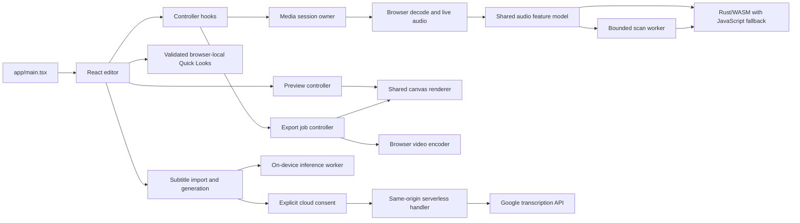

# Pulseframe architecture and behavior

Pulseframe is a single-track audio and video visualizer built with React,
TypeScript and Vite. The editor, audio analysis, canvas rendering, still-image
capture and video encoding run in the user's browser. The optional Gemini
subtitle method sends audio to Google's API only after the user chooses that
method and confirms the upload.

## Source layout

- `app/` contains the browser application, Vite entry/configuration, serverless
  subtitle handler, public assets and application tests. `app/Home.tsx` composes
  the editor; `app/components/` renders controls and dialogs; `app/hooks/`
  coordinates editor and media lifecycles. `app/lib/` groups audio analysis in
  `audio/`, browser resources in `media/`, settings and rendering in `visual/`,
  video jobs in `export/`, saved data and project files in `persistence/`, and
  caption logic in `subtitles/` and `lyrics/`. `dsp/` owns the worker and
  Rust/WASM adapters; shared preview, time and class-name helpers remain at the
  library root.
- `scripts/` contains root development helpers, runtime-asset preparation,
  reproducible DSP generation and benchmarks.
- `vendor/` is reserved for checked-in third-party assets; it is currently empty.
- `crates/pulseframe-dsp/` contains the Rust DSP crate. Its generated browser
  bindings and WASM are checked in under `app/public/dsp/` so deployment does
  not need Rust.
- Root package commands are the supported shortcuts for developing and
  building the app from the repository. Vercel's project root is `app`; because
  installation and build tooling also use repository-root files, enable access
  to source files outside that root in the Vercel project settings when applying
  the root-directory change.



React views display state and collect input. Hooks own orchestration,
cancellation and cleanup. UI-independent settings and file contracts live in
the application model code. Browser APIs are wrapped by media, persistence,
subtitle and encoder adapters. Preview and export share the canvas renderer and
the same source-time audio-response calculations.

## Media and DSP lifecycle

The editor handles one active track at a time. A replacement file or project is
prepared before it replaces the active session; a failed or canceled load keeps
the current project. The media-session owner manages media elements, decoded
audio, the Web Audio graph, images and object URLs. Replacement, cancellation
and teardown release resources through that owner. Exports and subtitle jobs
hold the shared editor lock while using a snapshot of the source and settings.

The analysis path uses a calibrated 4096-sample FFT, DC-removed RMS and
log-frequency bands. Measurements are causal and prepared at 30 Hz. The canvas
can draw at up to 60 FPS while reusing the latest measurement between analysis
frames; export probes at its selected 24, 30 or 60 FPS. Spectrum and Edge Bars
smooth and pool linear-amplitude energy over each bar's frequency range.
Finite FFT resolution means nearby low-frequency bands can still move together.

Rust/WASM implements FFT, RMS and band calculations. JavaScript keeps media
decoding, playback, artistic response, canvas drawing and video encoding. A
versioned browser/worker loader validates the generated engine and falls back to
JavaScript if initialization or a frame call fails. Scan workers transfer
bounded copies of PCM in cooperative batches; they do not detach media-session
buffers. Abort terminates the worker and incomplete scans are discarded. The
frame adapter owns and frees WASM handles, and copies values that must survive
memory growth or a later WASM call.

The Rust crate uses Rust 1.85.1 and wasm-bindgen CLI 0.2.100. Regenerate the
checked-in browser artifacts with `pnpm dsp:build`; deploys consume those
artifacts and require no Rust toolchain. The benchmark scripts measure DSP work
separately from decoding, transfer, rendering and encoding. A DSP speedup does
not imply the same speedup for a complete export.

## Visualizer, projects and Quick Looks

The current editor has three canvas modes: Pulse Ring, Spectrum and Edge Bars.
Pulse Ring defaults to Full sound and also offers Bass waves (35–450 Hz) and
Auto focus. All three use the shared audio analysis. Customization covers color
and backdrop, particles, motion, trails, beat lighting, glitch and drop accents,
logo fitting/placement, track text and the timer. Reduced-motion preferences
suppress decorative motion effects. The waveform, playback and range controls
operate on the active source.

### Motion and camera effects

In **Motion & effects**, Pulse Ring offers Orbit, Bounce, Drift, Rotate, Zoom
and Beat jump. Motion intensity controls travel, rotation or zoom; the existing
Motion speed controls repeating movement. The ring, orbit accents and uploaded
logo move together. Switching visual styles retains the ring settings.
Choose **Continuous** for looping motion through silent sections or
**Audio-reactive** to ease movement with a slower envelope derived from bass
hits and return toward rest during silence. This prevents individual transients
from snapping the ring's position. The motion response advances with source
audio time and is replayed when seeking; ring/logo pulses, Beat jump and camera
shake retain their faster beat response. Continuous is the default
for new and older saved settings. Beat jump always follows the bass envelope;
its behavior selector is disabled to avoid applying that response twice.
Reactive Rotate rocks within 15 degrees of its original angle at full intensity
and response, avoiding wraparound jumps when the envelope changes.
**Camera shake** works with all three styles and moves the background and
artwork in response to the existing bass-hit envelope. Beat jump uses that same
measured response. Titles, timer and subtitles remain steady for readability.
Both effects start off, including when loading older projects or Quick Looks,
and respect reduced motion in preview, PNG capture and video export.

`app/lib/visual/motion.ts` computes pure transforms from absolute media time,
dimensions, settings and the existing audio response. The shared canvas renderer
applies camera and object transforms, then restores screen coordinates before
drawing text. The logo receives matching transforms while retaining its layer
order. Pause holds the pose, seeking evaluates the destination time, and exports
evaluate the absolute source time. Camera noise is deterministic; transforms
do not accumulate frame state or require another animation loop or DSP path.
Settings participate in project and Quick Look persistence, undo/redo, Motion
section reset and export snapshots.

The [reference demonstration](https://chatgpt.com/s/t_6ad77fcef05c8191bceb28b7d6af9d63)
informs the movement choices; Pulseframe uses measured audio and its media clock.
Ring translation is bounded to a circle around the original position with a
maximum radius of 8% of the short canvas edge, reduced by Motion intensity.
This limit includes diagonal travel and applies to both behaviors. Each pose is
computed from the original composition, so long tracks and repeated seeks
cannot accumulate drift. Zoom remains bounded to 12% above the original scale.
The travel limit constrains the group center; large artwork can still crop.
Camera overscan covers the whole backdrop and slightly crops the artwork during a shake.
High ring scale or logos near an edge can still crop during object motion; use
the preview to compose them. These effects reuse the existing audio envelope
rather than inferring another beat grid.

### Projects and Quick Looks

A project file is portable: it contains a validated manifest, the source media,
and optional logo/background image bytes, plus appearance settings, subtitles
and export settings. Saving writes the current format; reading supports older
project versions and migrates legacy visual modes. Applying a Quick Look changes
appearance and audio-response settings while keeping the active track, images,
subtitles, track text and export choices.

Built-in looks have stable IDs and complete settings snapshots. Personal Quick
Looks are validated in the browser's `pulseframe.presets.v1` localStorage record.
They survive reloads on the same browser and origin, but do not sync to another
browser or domain. They exclude media, images, subtitles and title/artist text.
Names are limited to 80 characters. Revision checks prevent stale edits; Web
Locks serialize mutations across same-origin tabs where supported. Browser
storage limits and private-browsing behavior still apply. Project files transfer
media and appearance across origins.

## Subtitles, privacy and runtime assets

Subtitle files can be imported locally as SRT, WebVTT, LRC or Pulseframe JSON.
Import previews and validates the file before applying it. Automatic generation
uses the complete active track; exports trim and rebase the selected range.
Preview and export draw active nonblank cues in stable start-time order. The
editor accepts up to 500 cues with at most 600 characters per cue; a complete
generated result can still be downloaded when it exceeds those editor limits.

On-device generation is the default and runs in a dedicated worker. Fast uses
quantized Whisper Tiny. Auto uses Tiny and adds Kim Vocal 2 vocal isolation only
when the browser's GPU and memory checks allow it; an isolation failure is
reported and transcription can continue on the original mix. Quality uses
quantized Whisper Base with vocal isolation and stops if that isolation fails.
Language defaults to Auto; both methods accept a hint from their supported language list.
Local generation admits mono/stereo sources up to 100 MiB and ten minutes,
subject to an estimated memory budget. Model files are pinned remote artifacts,
downloaded when needed and cached by the browser; they are not bundled in this
repository.

Gemini is optional. The browser sends prepared mono PCM16 WAV chunks to the
same-origin serverless handler, which calls Google's Files and transcription
APIs. Chunks are at most 100 seconds and are uploaded sequentially with a short
overlap. Gemini Quality isolates vocals on device before uploading; isolation
failure stops the job without uploading the original mix. Fast and Auto upload
the original mix. The server key (`GEMINI_API_KEY`) is optional; a supplied session key
takes precedence, and a rejected session key does not fall back to the server
key. Configure the server key only in the hosting provider's sensitive
environment settings. The default provider model is `gemini-3.5-transcribe`;
`GEMINI_MODEL` can select a compatible transcription model. The development
server routes through the same handler; static preview alone does not provide
the API.

Choosing Gemini and confirming generation is the upload consent. The session
key is held in application memory and request headers, then cleared when
disconnected; it is not written to projects, Quick Looks, storage or URLs.
Uploaded audio is sent to Google and API use may incur charges. Cancellation
prevents further requests where possible, but cannot undo a provider request
already accepted. The handler bounds request size and validates input and
provider responses. Logs contain fixed status/error codes and numeric timing
diagnostics, not API keys, audio or transcript text. The handler deletes
uploaded Google files after an attempt; failed deletion can leave a file with
Google for up to 48 hours. Process-local request limits are best-effort and are
not a global spending limit.

Whisper Tiny is pinned to revision
[`ff4177021cc41f7db950912b73ea4fdf7d01d8e7`](https://huggingface.co/onnx-community/whisper-tiny/tree/ff4177021cc41f7db950912b73ea4fdf7d01d8e7);
Whisper Base is pinned to
[`1846881b6b3a3024392c1eea3ad983695bc23925`](https://huggingface.co/onnx-community/whisper-base/tree/1846881b6b3a3024392c1eea3ad983695bc23925).
Kim Vocal 2 is pinned to UVR resources revision
[`83719e1e624d07842f914d856722af6f463e88cb`](https://huggingface.co/Politrees/UVR_resources/tree/83719e1e624d07842f914d856722af6f463e88cb);
the implementation checks its 66,759,214-byte file against SHA-256
`ce74ef3b6a6024ce44211a07be9cf8bc6d87728cc852a68ab34eb8e58cde9c8b`.
None of these model weights are included in the repository. The pinned Whisper
model cards do not declare a license field; their linked metadata is not
sufficient to settle converted-weight redistribution terms. Kim's pinned
[upstream README](https://huggingface.co/Politrees/UVR_resources/blob/83719e1e624d07842f914d856722af6f463e88cb/README.md)
declares MIT, but a separate license statement for the weight file was not
found. Resolve the weight terms before redistributing them. The Rust crate's
`Cargo.toml` marks the crate `UNLICENSED`, and this repository has no root
`LICENSE` file.

The browser inference runtimes are pinned to Transformers.js 3.8.1 and
ONNX Runtime Web 1.22.0. `pnpm dev` and `pnpm build` prepare the separate
`app/public/whisper-ort/` and `app/public/mdx-ort/` runtime asset directories
from installed packages. The deployment sends the COOP `same-origin` and COEP
`credentialless` headers required by the worker configuration. Embedding the
editor in another site's iframe may need different headers.

## Export behavior and limits

Video export supports landscape, portrait and square formats; 480p, 720p,
1080p and 1440p resolutions; and 24, 30 or 60 FPS. New sessions default to
720p/30 FPS. Resolution controls the short edge for landscape and portrait, and
the edge for square; dimensions are even for codec compatibility. Export uses
the browser's available encoders and produces MP4 or WebM. Unsupported
dimensions or encoders report an error instead of silently lowering output
quality.

Optional video compression is off by default. It uses Mediabunny's 0.68 quality
target in place of the high-quality 0.75 setting and may reduce detail. It does
not change resolution, frame rate, audio, duration or subtitles. File-size
savings vary by clip, codec and device. Project files preserve the setting;
older ZIP-compression fields do not enable it.

Before asynchronous preparation, export snapshots appearance, subtitles and
range and retains source resources under the shared lock. Cancellation prevents
late progress and download after the job settles. Time estimates use recent
successful compatible runs from this browser (at most 20 records, expiring
after 45 days) and current-device rendering progress. The stored profile omits
media names, track titles, PCM and exact appearance values. Estimates are ranges
and are unavailable until the browser has enough timing data.

Five-minute tracks are the current performance target, not a hard maximum for
all editor actions. Browser codec support and memory determine practical media
and export limits. On-device subtitle generation has its separate ten-minute
admission limit described above. No playlist or account-backed preset service
is part of the current application.

## Development commands

Use Node.js 22.13 or later and pnpm 11.25.0 as pinned by the root package.
Supported commands run from the repository root:

```sh
pnpm install --frozen-lockfile
pnpm dev
pnpm test
pnpm lint
pnpm typecheck
pnpm build
pnpm preview
```

For Rust/DSP work, also run `cargo test --locked --manifest-path
crates/pulseframe-dsp/Cargo.toml` and `pnpm dsp:build`. The project is a Vite
static app on Vercel; checked-in DSP assets mean hosting builds need Node and
pnpm, not Rust. Optional Gemini deployment requires the sensitive server
environment key described above.
