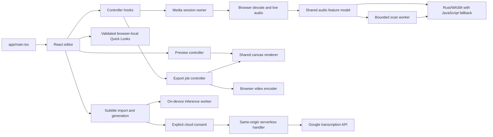

# Pulseframe architecture and behavior

Pulseframe is a single-track audio and video visualizer built with React,
TypeScript and Vite. The editor, audio analysis, canvas rendering, still-image
capture and video encoding run in the user's browser. The optional Gemini
subtitle method sends audio to Google's API only after the user chooses that
method and confirms the upload.

## Source layout

- `app/` contains the browser application, Vite entry/configuration, serverless
  subtitle handler, public assets and application tests. `app/Home.tsx` composes
  the editor; `app/components/` renders controls and dialogs; `app/hooks/`
  coordinates editor and media lifecycles. `app/lib/` groups audio analysis in
  `audio/`, browser resources in `media/`, settings and rendering in `visual/`,
  video jobs in `export/`, saved data and project files in `persistence/`, and
  caption logic in `subtitles/` and `lyrics/`. `dsp/` owns the worker and
  Rust/WASM adapters; shared preview, time and class-name helpers remain at the
  library root.
- `scripts/` contains root development helpers, runtime-asset preparation,
  reproducible DSP generation and benchmarks.
- `vendor/` is reserved for checked-in third-party assets; it is currently empty.
- `crates/pulseframe-dsp/` contains the Rust DSP crate. Its generated browser
  bindings and WASM are checked in under `app/public/dsp/` so deployment does
  not need Rust.
- Root package commands are the supported shortcuts for developing and
  building the app from the repository. Vercel's project root is `app`; because
  installation and build tooling also use repository-root files, enable access
  to source files outside that root in the Vercel project settings when applying
  the root-directory change.



React views display state and collect input. Hooks own orchestration,
cancellation and cleanup. UI-independent settings and file contracts live in
the application model code. Browser APIs are wrapped by media, persistence,
subtitle and encoder adapters. Preview and export share the canvas renderer and
the same source-time audio-response calculations.

## Media and DSP lifecycle

The editor handles one active track at a time. A replacement file or project is
prepared before it replaces the active session; a failed or canceled load keeps
the current project. The media-session owner manages media elements, decoded
audio, the Web Audio graph, images and object URLs. Replacement, cancellation
and teardown release resources through that owner. Exports and subtitle jobs
hold the shared editor lock while using a snapshot of the source and settings.

The analysis path uses a calibrated 4096-sample FFT, DC-removed RMS and
log-frequency bands. Measurements are causal and prepared at 30 Hz. The canvas
can draw at up to 60 FPS while reusing the latest measurement between analysis
frames; export probes at its selected 24, 30 or 60 FPS. Spectrum and Edge Bars
smooth and pool linear-amplitude energy over each bar's frequency range.
Finite FFT resolution means nearby low-frequency bands can still move together.

Rust/WASM implements FFT, RMS and band calculations. JavaScript keeps media
decoding, playback, artistic response, canvas drawing and video encoding. A
versioned browser/worker loader validates the generated engine and falls back to
JavaScript if initialization or a frame call fails. Scan workers transfer
bounded copies of PCM in cooperative batches; they do not detach media-session
buffers. Abort terminates the worker and incomplete scans are discarded. The
frame adapter owns and frees WASM handles, and copies values that must survive
memory growth or a later WASM call.

The Rust crate uses Rust 1.85.1 and wasm-bindgen CLI 0.2.100. Regenerate the
checked-in browser artifacts with `pnpm dsp:build`; deploys consume those
artifacts and require no Rust toolchain. The benchmark scripts measure DSP work
separately from decoding, transfer, rendering and encoding. A DSP speedup does
not imply the same speedup for a complete export.

## Visualizer, projects and Quick Looks

The editor has five first-class canvas modes: Pulse Ring, Spectrum, Edge Bars,
Radial Spectrum and Spectral Terrain.
Pulse Ring defaults to Full sound and also offers Bass waves (35–450 Hz) and
Auto focus. All five styles use the shared audio analysis. Customization covers color
and backdrop, particles, motion, trails, beat lighting, glitch and drop accents,
logo fitting/placement, track text and the timer. Reduced-motion preferences
suppress decorative motion effects. The waveform, playback and range controls
operate on the active source.

### Style rendering and source-time history

`app/lib/visual/styles/types.ts` defines the React-independent style contract.
The static registry chooses one primary renderer. Background/video, atmosphere,
lighting, particles, logo fitting, titles and subtitles remain in the shared
`drawVisualization` pipeline used by preview, PNG capture and video export.
The original three drawing algorithms live in separate modules with their
existing audio calculations preserved; their public geometry helpers remain
exported from `visualizer.ts` for compatibility. Edge Bars maps its gradient to
each visible bar, with a 75%/25% primary/accent balance and a soft transition
across the latter half of its length.

New style settings are typed groups (`radialOptions`, `terrainOptions`), with per-property validation/defaults. Existing flat options
are retained. Missing groups in older projects and Quick Looks receive defaults;
the project format remains version 2 and preset storage remains version 1.
Retired IDs still migrate explicitly to Ring or Spectrum and are not new styles.
All five modes retain separate logo layouts. Nested controls have separate undo
groups, and Visual section reset restores the active look's option groups.

Prepared frequency history references the existing 30 Hz WASM/JavaScript
envelopes. It converts log-display bands to calibrated linear amplitudes,
combines stereo by energy, gates quiet measurements, and uses a causal weighted
three-frame response with interpolation. Rendering at a source timestamp does
not depend on previous draw calls or export FPS. Converted samples are cached
in a maximum of 384 frames, roughly 144 KiB of float payload, rather than copying
the whole track. No FFT runs inside a style or for a terrain vertex.

The live/unprepared fallback retains at most 304 measured frames (ten seconds
plus interpolation support). It clears on media replacement, seek, backwards
time or a discontinuity. Unknown past times return unavailable and are drawn
without invented historical energy. Preview and PNG capture use the same source;
offline export supplies the same history adapter with its absolute decode
offset. New-style export preroll is aligned to the source analysis grid and includes
an extra 1.15 seconds at the maximum history depth (900 ms response lookback
plus 250 ms of analysis-filter warm-up).
Terrain uses a source-time peak-release adapter in `audio-response.ts`.
It preserves current causal attacks, then lets bass/mids/treble settle at about
180/125/75 ms respectively. The finite exponential kernel fades to zero at its
900 ms lookback limit. Only measured past audio contributes, so no frame-clock
simulation or FFT is needed. Two 384-frame caches add at most about 288 KiB of
float payload per source for Terrain. Live-history revisions and
quiet-threshold changes invalidate caches; source ownership remains weak.

The renderer owns no media elements, worker, encoder or React state.

- **Radial Spectrum:** distinct polar bars sample the calibrated logarithmic
  frequency axis. Clockwise and mirrored mappings, outward/inward/both variants,
  and source-time rotation share one renderer. Inner radius and maximum length
  are percentages of the short canvas edge before fitting; geometry and Visual
  size are normalized together to a 44% radius with glow clearance. Bar width is
  a percentage of its angular step, roundness a percentage of half its width,
  and 100% rotation speed is one revolution per minute. Inward variants preserve
  the central logo aperture.
- **Spectral Terrain:** a 32×24, 48×40 or 64×64 frequency/history mesh samples a
  two-to-ten-second source-time window. Interior rows retain fixed source
  timestamps while their projected depths advance; boundary rows follow the
  current window. This carries measured ridges through the scene instead of
  reshaping past audio on a stationary grid. A small frequency filter makes readable
  ridges. Bounded monotone cubic contours pass through measured frequency
  vertices, and the optional fill uses the same contour as the wire. Continuous
  depth fading reduces distant contrast, while row energy subtly shades fills.
  Stable perspective projects it into bounded screen coordinates; peak
  height does not shrink when density increases. Travel speed controls an
  illuminated contour crossing the landscape, independently of the actual
  history window and audio clock. It interpolates by actual row depths so row
  rollover cannot shift the highlight. Entering/leaving horizontal lines fade over
  one row interval in both the base and glow passes to avoid brightness changes.
  The traveling contour uses the same smooth curve and depth fade. Pausing holds it;
  reduced motion removes that
  decorative contour. Earlier ridges can occlude later valleys in projection.

Geometry buffers are bounded and reused where useful. Canvas contexts and
prepared envelopes key weak caches, so releasing their owners permits cleanup.
Export timing history separates the new modes and coarse bar-count/grid
workloads. Terrain uses a revised workload signature so its previous render
timings cannot bias estimates; other mode keys remain unchanged. Encoding, compression,
resolution and FPS behavior are unchanged.

Retired identifiers are accepted only during import and map to a supported
style. The retired `blob` identifier maps to Pulse Ring; obsolete options and logo
keys are stripped after migration. Project and preset versions stay unchanged.

The built-in Quick Looks contain exactly one look per visual style: Contour
(Ring), After Hours (Spectrum), Counterflow (Edges), Orbit (Radial), and Neon
Horizon (Terrain). Each enables 24–40 particles by default;
reapplying a built-in look picks up these defaults. Personal Quick Looks remain unchanged, with
the same save/apply/reset workflows. Advanced controls remain collapsed initially. See [the engineering report](visual-styles-engineering-report.md)
for verification, measurements and limits.

A project file is portable: it contains a validated manifest, the source media,
and optional logo/background image bytes, plus appearance settings, subtitles
and export settings. Saving writes the current format; reading supports older
project versions and migrates legacy visual modes. Applying a Quick Look changes
appearance and audio-response settings while keeping the active track, images,
subtitles, track text and export choices.

Built-in looks have stable IDs and complete settings snapshots. Personal Quick
Looks are validated in the browser's `pulseframe.presets.v1` localStorage record.
They survive reloads on the same browser and origin, but do not sync to another
browser or domain. They exclude media, images, subtitles and title/artist text.
Names are limited to 80 characters. Revision checks prevent stale edits; Web
Locks serialize mutations across same-origin tabs where supported. Browser
storage limits and private-browsing behavior still apply. Project files transfer
media and appearance across origins.

## Subtitles, privacy and runtime assets

Subtitle files can be imported locally as SRT, WebVTT, LRC or Pulseframe JSON.
Import previews and validates the file before applying it. Automatic generation
uses the complete active track; exports trim and rebase the selected range.
Preview and export draw active nonblank cues in stable start-time order. The
editor accepts up to 500 cues with at most 600 characters per cue; a complete
generated result can still be downloaded when it exceeds those editor limits.

On-device generation is the default and runs in a dedicated worker. Fast uses
quantized Whisper Tiny. Auto uses Tiny and adds Kim Vocal 2 vocal isolation only
when the browser's GPU and memory checks allow it; an isolation failure is
reported and transcription can continue on the original mix. Quality uses
quantized Whisper Base with vocal isolation and stops if that isolation fails.
Language defaults to Auto; both methods accept a hint from their supported language list.
Local generation admits mono/stereo sources up to 100 MiB and ten minutes,
subject to an estimated memory budget. Model files are pinned remote artifacts,
downloaded when needed and cached by the browser; they are not bundled in this
repository.

Gemini is optional. The browser sends prepared mono PCM16 WAV chunks to the
same-origin serverless handler, which calls Google's Files and transcription
APIs. Chunks are at most 100 seconds and are uploaded sequentially with a short
overlap. Gemini Quality isolates vocals on device before uploading; isolation
failure stops the job without uploading the original mix. Fast and Auto upload
the original mix. The server key (`GEMINI_API_KEY`) is optional; a supplied session key
takes precedence, and a rejected session key does not fall back to the server
key. Configure the server key only in the hosting provider's sensitive
environment settings. The default provider model is `gemini-3.5-transcribe`;
`GEMINI_MODEL` can select a compatible transcription model. The development
server routes through the same handler; static preview alone does not provide
the API.

Choosing Gemini and confirming generation is the upload consent. The session
key is held in application memory and request headers, then cleared when
disconnected; it is not written to projects, Quick Looks, storage or URLs.
Uploaded audio is sent to Google and API use may incur charges. Cancellation
prevents further requests where possible, but cannot undo a provider request
already accepted. The handler bounds request size and validates input and
provider responses. Logs contain fixed status/error codes and numeric timing
diagnostics, not API keys, audio or transcript text. The handler deletes
uploaded Google files after an attempt; failed deletion can leave a file with
Google for up to 48 hours. Process-local request limits are best-effort and are
not a global spending limit.

Whisper Tiny is pinned to revision
[`ff4177021cc41f7db950912b73ea4fdf7d01d8e7`](https://huggingface.co/onnx-community/whisper-tiny/tree/ff4177021cc41f7db950912b73ea4fdf7d01d8e7);
Whisper Base is pinned to
[`1846881b6b3a3024392c1eea3ad983695bc23925`](https://huggingface.co/onnx-community/whisper-base/tree/1846881b6b3a3024392c1eea3ad983695bc23925).
Kim Vocal 2 is pinned to UVR resources revision
[`83719e1e624d07842f914d856722af6f463e88cb`](https://huggingface.co/Politrees/UVR_resources/tree/83719e1e624d07842f914d856722af6f463e88cb);
the implementation checks its 66,759,214-byte file against SHA-256
`ce74ef3b6a6024ce44211a07be9cf8bc6d87728cc852a68ab34eb8e58cde9c8b`.
None of these model weights are included in the repository. The pinned Whisper
model cards do not declare a license field; their linked metadata is not
sufficient to settle converted-weight redistribution terms. Kim's pinned
[upstream README](https://huggingface.co/Politrees/UVR_resources/blob/83719e1e624d07842f914d856722af6f463e88cb/README.md)
declares MIT, but a separate license statement for the weight file was not
found. Resolve the weight terms before redistributing them. The Rust crate's
`Cargo.toml` marks the crate `UNLICENSED`, and this repository has no root
`LICENSE` file.

The browser inference runtimes are pinned to Transformers.js 3.8.1 and
ONNX Runtime Web 1.22.0. `pnpm dev` and `pnpm build` prepare the separate
`app/public/whisper-ort/` and `app/public/mdx-ort/` runtime asset directories
from installed packages. The deployment sends the COOP `same-origin` and COEP
`credentialless` headers required by the worker configuration. Embedding the
editor in another site's iframe may need different headers.

## Export behavior and limits

Video export supports landscape, portrait and square formats; 480p, 720p,
1080p and 1440p resolutions; and 24, 30 or 60 FPS. New sessions default to
720p/30 FPS. Resolution controls the short edge for landscape and portrait, and
the edge for square; dimensions are even for codec compatibility. Export uses
the browser's available encoders and produces MP4 or WebM. Unsupported
dimensions or encoders report an error instead of silently lowering output
quality.

Optional video compression is off by default. It uses Mediabunny's 0.68 quality
target in place of the high-quality 0.75 setting and may reduce detail. It does
not change resolution, frame rate, audio, duration or subtitles. File-size
savings vary by clip, codec and device. Project files preserve the setting;
older ZIP-compression fields do not enable it.

Before asynchronous preparation, export snapshots appearance, subtitles and
range and retains source resources under the shared lock. Cancellation prevents
late progress and download after the job settles. Time estimates use recent
successful compatible runs from this browser (at most 20 records, expiring
after 45 days) and current-device rendering progress. The stored profile omits
media names, track titles, PCM and exact appearance values. Estimates are ranges
and are unavailable until the browser has enough timing data.

Five-minute tracks are the current performance target, not a hard maximum for
all editor actions. Browser codec support and memory determine practical media
and export limits. On-device subtitle generation has its separate ten-minute
admission limit described above. No playlist or account-backed preset service
is part of the current application.

## Development commands

Use Node.js 22.13 or later and pnpm 11.25.0 as pinned by the root package.
Supported commands run from the repository root:

```sh
pnpm install --frozen-lockfile
pnpm dev
pnpm test
pnpm lint
pnpm typecheck
pnpm build
pnpm preview
```

For Rust/DSP work, also run `cargo test --locked --manifest-path
crates/pulseframe-dsp/Cargo.toml` and `pnpm dsp:build`. The project is a Vite
static app on Vercel; checked-in DSP assets mean hosting builds need Node and
pnpm, not Rust. Optional Gemini deployment requires the sensitive server
environment key described above.
