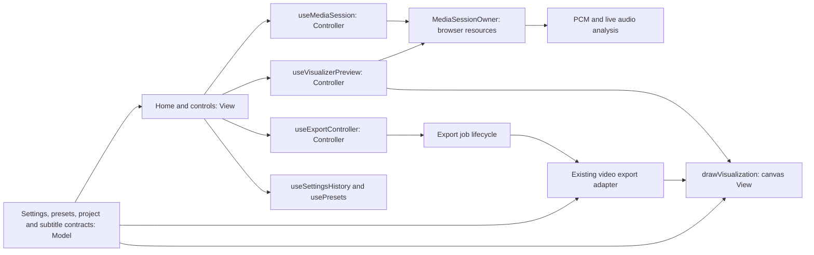

# Pulseframe architecture

Pulseframe uses React views and controller hooks. Shared settings and file
contracts live in `lib`; browser media resources have a single concrete owner.
This keeps the existing React application while making its lifecycle boundaries
explicit. There is no new global store, service container, or plugin framework.

## Responsibilities

| Boundary                   | Files                                                                                                                                                | Responsibility                                                                                                          |
| -------------------------- | ---------------------------------------------------------------------------------------------------------------------------------------------------- | ----------------------------------------------------------------------------------------------------------------------- |
| View and composition       | `app/page.tsx`, `components/*`                                                                                                                       | Layout, dialogs, editor actions and presentation                                                                        |
| Domain contracts           | `lib/visual-settings-model.ts`, `lib/customizer-config.ts`, `lib/presets.ts`, `lib/project-file.ts`, `lib/subtitles.ts`                              | Settings, defaults, validation and serialization                                                                        |
| Analysis                   | `lib/audio-analysis-config.ts`, `lib/audio-features.ts`, `lib/audio-dsp.mjs`, `lib/art-reactivity.mjs`, `lib/drop-detector.mjs`, `lib/live-sound.ts` | Shared cadence, PCM/live features and drop detection                                                                    |
| Browser resource ownership | `lib/media-session.ts`, `hooks/use-media-session.ts`                                                                                                 | Media elements, audio graph, decoded sound, image assets and transport                                                  |
| Preview orchestration      | `hooks/use-visualizer-preview.ts`, `lib/preview-state.ts`                                                                                            | Frame loop, sizing, reduced motion, seek response replay and PNG capture                                                |
| Canvas rendering           | `lib/visualizer.ts`, `lib/track-overlay.ts`, `lib/beat-lighting.ts`, `lib/glitch.ts`                                                                 | Existing visual composition and response equations                                                                      |
| Export orchestration       | `hooks/use-export-controller.ts`, `lib/export-job.ts`, `lib/export-time-estimate.ts`                                                                 | Input snapshot, shared lock, measured progress and estimates, successful-run history, cancellation and download cleanup |
| Persistence                | `hooks/use-presets.ts`, `lib/preset-store.ts`                                                                                                        | Validated browser-local preset persistence and cross-tab refresh                                                        |

The browser session snapshot exposes resource handles for preview and export.
It is an infrastructure API, not a persisted project or a UI-independent model.
Settings, presets and serializers must not import controller hooks or components.

## Lifecycle rules

- A replacement stages its media and project images first. Successful commit
  installs the new snapshot, notifies consumers, and then releases old resources.
  Failed or canceled replacements retain the active project.
- Request generations reject old load results. Successful-commit generations
  reject preview work belonging to another media session. Transport tokens also
  reject play requests invalidated during asynchronous audio resume.
- Preview replays complete retained sound history when seeking. Replay yields
  between small batches and rejects changed settings, seeks or media. Cached
  response states are cloned before rendering can mutate them.
- Export captures settings, subtitles and range before lazy encoder loading.
  PCM and image resources remain referenced while the shared lock prevents media
  replacement. Cancel keeps the lock until encoding settles and suppresses late
  progress and downloads. Teardown aborts work and releases retained URLs.
- Export timing counts frame work only after each awaited encoder submission.
  The controller measures from the click through lazy loading and preparation,
  then keeps rendering and finalization timings separate. It learns live rates
  after a warmup and stores only bounded, expiring timings for successful,
  compatible runs in browser storage. The pipeline version scopes history so a
  future renderer can invalidate it without affecting export output.
- Preset metadata updates preserve the originally applied appearance snapshot.
  Applying or saving a look deliberately establishes a new reset baseline.

## Scope and checks

The application is a Vite/React static site on Vercel. Quick Looks use browser-local storage; there is no preset API or database service.

The application still edits one track at a time. Five-minute tracks are the
current target; a future playlist can sequence track sessions without introducing
playlist state into this refactor. Browser codecs and memory still determine
which export sizes and track lengths a device can process.

Run regression checks with `node --test tests/*.test.mjs`, type checking with
`node_modules/.bin/tsc --noEmit --incremental false`, and the project build with
`pnpm build`. Browser verification should cover both desktop and mobile
viewports, long seeks, preset metadata/reset behavior, project restoration,
PNG capture, and successful/canceled short video exports.

Automatic subtitle generation holds the same editor/export lock as media
replacement and video export. On-device inference runs in a dedicated worker.
Gemini audio is sent only after explicit method selection, consent and a Generate
action; all provider requests pass through the same-origin serverless function.
The supplied session key takes precedence, with the server key used only when no
client key is supplied. The canvas renderer draws simultaneous cues in stable
start-time order so preview and exported frames share the same layout.
