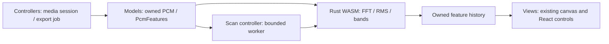

# Pulseframe DSP engine

Rust/WASM supplies calibrated FFT, RMS, and frequency bands. JavaScript keeps browser decoding, playback, artistic response, canvas drawing, and video encoding. The existing visuals, 30 Hz prepared history, full seek replay, and exact 24/30/60 fps export probes are preserved.



`lib/pcm-features.ts` is the synchronous frame model. `lib/audio-features.ts` keeps its public compatibility exports and prepared-sound helpers. The shared loader initializes only in the browser/worker, validates the core and feature versions, and gives up after four seconds. Failed initialization uses the JavaScript implementation; a trapped frame handle is freed once and falls back without retrying on each animation frame. The internal `?dsp=js` URL switch forces JavaScript for frame probes and prepared scan workers without changing project settings. Diagnostic Hann peak fitting is requested explicitly rather than performed during production frame analysis.

The scan client transfers copies of bounded PCM chunks, with enough trailing history for the 4096-point FFT and 20 ms RMS. It never transfers an AudioBuffer channel or a WASM memory buffer. One chunk is outstanding at a time. The worker uses 15-frame batches and cooperative scheduling, retains the existing bass-return detector state across chunks, and transfers compact owned results. Jobs validate protocol/schema versions and reject late results. Abort terminates the worker; failure discards partial results and restarts a complete cooperative scan. Only complete scans reach the media owner.

Vite resolves the module worker through a static `?worker&url` import. Development and production use the same React/Vite configuration; no server framework or worker-HMR workaround is required. Vercel serves the emitted worker and the public WASM assets as static files.

Frame handles are freed on track replacement, failed candidate preparation, live graph disposal, and export completion/failure. Retained bands are copied out of WASM; short-lived spectrum views are refreshed after memory growth. The browser still owns one full decoded PCM buffer. Scratch and transferred PCM are bounded independently of track duration, while the existing feature history scales with duration under the decoder's cache budget.

`TemporalDsp` is an optional experimental capability using chronological 2048-sample windows and 512-sample hops. It returns spectral flux, onset timestamp/strength, coarse tempo, phase, confidence and causal latency. Repeated, backward or discontinuous sample positions reset its history. It does not run during regular preview/export and does not drive drop effects. `node scripts/benchmark-rhythm.mjs` evaluates its compiled implementation against annotated synthetic clicks. Real music and live capture need further validation. The inexpensive legacy bass-return heuristic stays in JavaScript to preserve behavior; AudioWorklet capture, playlists, SIMD, and threads are separate work.

## Building and verifying

Node-only hosting uses checked-in generated files under `public/dsp/`; it does not need Rust at deploy time. Regenerate them with Rust 1.85.1, the `wasm32-unknown-unknown` target, and wasm-bindgen CLI 0.2.100:

```sh
cargo install wasm-bindgen-cli --version 0.2.100 --locked
pnpm dsp:build
cargo test --locked --manifest-path crates/pulseframe-dsp/Cargo.toml
node --test tests/*.test.mjs
pnpm exec tsc --noEmit --incremental false
```

`Cargo.lock` pins dependencies, including scalar f64 RustFFT 6.4.1. DSP CI regenerates assets and rejects drift before running application and compiled-WASM parity tests. Cargo output/build staging are ignored; generated bindings are excluded from hand-authored lint rules.

Generated JavaScript and WASM URLs share the core version query. Bump the Rust core version and matching TypeScript contract version together when changing the deployed DSP implementation, then regenerate all four assets.

`node scripts/benchmark-dsp.mjs 300` compares the full synchronous adapter on a five-minute, 48 kHz stereo fixture, including window and retained-band copies. It uses diagnostic-free JavaScript as its baseline. This measures DSP only, not decoding, worker scheduling, rendering, or encoding. Browser/device benchmarks must establish end-to-end gains separately; a faster DSP engine does not guarantee a proportional export-speed improvement.

## Measured validation (7 October 2026)

On the shared Linux cloud executor (Node 24.19.0), three alternating warm runs on 300 seconds of 48 kHz stereo PCM produced a median of **5,102.5 ms** for diagnostic-free JavaScript and **2,216.9 ms** for the WASM adapter: **56.6% less DSP scan time**. The last-run p95 synchronous probe was 0.69 ms versus 0.38 ms. This excludes browser worker traffic, decoder, canvas and encoder costs; it is not a YouTube export-speed estimate or a physical mobile-device result.

Profiling first found a software square-root implementation reached through `Complex::norm()`. Replacing it with inherent `f64.sqrt()` removed that hotspot while retaining calibration/parity tests. This avoids adding SIMD or another dependency. The optional synthetic 120 BPM click fixture detected all 38 annotated onsets at 44.1/48 kHz, with nearest-onset errors under 24 ms and an approximately 120 BPM candidate. It does not establish accuracy on real music.

Chromium on the same cloud device confirmed actual worker backends on a 30-second, 48 kHz stereo fixture: alternating warmed scans took **766 ms for JavaScript** and **434 ms for WASM**, approximately **43% less worker scan time**, including bounded transfers and retained results. Each returned 900 frames in ten chunks, with copied PCM transfers no larger than 1,184,768 bytes; workers terminated without errors. A five-minute UI import also used the WASM worker successfully. These small browser samples exclude decoding, fixture generation and video export, and do not replace physical-device benchmarks.
