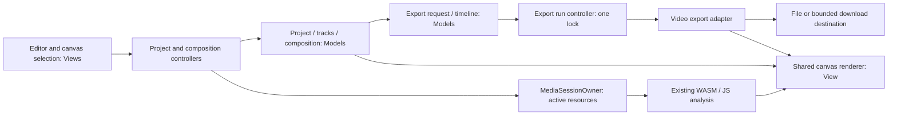

# Pulseframe implementation plan

Prepared 9 October 2026 as a planning document. The implementation is described
in [release studio](release-studio.md), with performed checks and remaining
verification limits in [validation results](release-studio-validation.md).
The baseline locations below refer to the repository before implementation.

## Decisions and scope

Implement market recommendations 1–8 on the existing React/TypeScript/Vite application and its MVC boundaries. Keep media processing on the user's device and Vercel serving static assets. Preserve Rust/WASM analysis, JavaScript fallback, existing visual response, local Quick Looks, optional compression off by default, and 480p/720p/1080p/1440p with 24/30/60 FPS.

The user confirmed canvas selection with drag/resize handles and precise controls. They also established the following distinction:

- **Playlist:** one project containing multiple tracks; its video export is one continuous video. Do not silently turn it into separate track exports.
- **Batch:** an ordered collection of independent export requests; each request produces its own file. A request may export a single-track project or a playlist project.
- **Release package:** coordinated output requests from the same project, such as a full video, a vertical teaser and a thumbnail. It uses the batch execution mechanism when that mechanism becomes available.

Defaults proposed for implementation: hard visual cuts and contiguous audio between playlist tracks; shared appearance and branding; per-track title, artist, captions and optional artwork; an editable teaser range; one selected thumbnail time. Crossfades, a general animation timeline, uploaded fonts, cloud rendering, accounts and automated transcription are deferred. They are not dependencies of this plan.

## Existing implementation and concrete gaps

| Area | Existing implementation | Gap to address |
| --- | --- | --- |
| Export lifecycle | `hooks/use-export-controller.ts:82` snapshots settings/range/cues; `lib/export-job.ts:111` owns the shared lock and cancellation; `lib/export-video.ts:247` renders exact timeline frames with awaited encoder submissions | Output is accumulated in `BufferTarget` at `lib/export-video.ts:165` and converted to a Blob at line 322; results assume a Blob download |
| Audio and memory | `lib/media-audio.ts:3` caps PCM plus history at 300 MiB; five-second audio sections avoid another full PCM allocation; WASM scan transfers bounded owned chunks | Output memory is separate from the PCM cap; staging a replacement can temporarily retain old and new decoded tracks |
| Composition | `lib/track-overlay.ts:20` computes overlay layout; `lib/visualizer.ts:723` computes logo geometry; preview, PNG and video use the same renderer | No canvas hit testing; geometry is partly private; background is centered/cropped; no separate cover-art slot or promo-text block |
| Quick Looks | Eight built-in looks, local personal presets, reset baselines, search/pinning/revisions | Cards are CSS illustrations; image assets and track text are outside the preset contract |
| Captions | `lib/subtitles.ts:1` stores source-time cues; `components/subtitle-dialog.tsx:53` provides manual editing | No SRT/VTT import/export or bulk timing operations |
| Highlight data | `lib/audio-features.ts:25` exposes RMS/band envelopes, overview and bass-return timestamps | No candidate-window scorer; experimental Rust temporal DSP is not integrated into normal preview/export |
| Projects | `lib/project-file.ts:19` accepts v1/v2 manifests; Blob composition/slicing embeds one media file plus logo/background | No track collection, composition record or cover-art payload |
| Export requests | One active source and one output per job | No request queue, release recipe or playlist timeline |

The formatting PR #12 is merged. Start implementation from a fresh current `main`, rather than extending the old formatting worktree. Reconcile any later changes before coding.

## Architecture and data ownership

Continue using models for validated values and algorithms, controller hooks for orchestration, React/canvas views for presentation, and concrete browser adapters for resources. Do not add a global store, service container, plugin framework or generic command bus.

The project model stores original File/Blob references and plain metadata. It never stores media elements, object URLs, AudioBuffers, WASM handles, encoders or prepared session snapshots. Resource owners derive those handles for the active preview or export segment and release them on settlement.

Introduce only the contracts needed for these features:

| Contract | Responsibility |
| --- | --- |
| Project document | Shared appearance, composition, default assets, ordered tracks, selected track and output settings |
| Track entry | Stable ID, original media reference, duration metadata, selected source range, title/artist, source-time cues and optional artwork override |
| Composition | Validated element layout, aspect-specific overrides and a small promo-text block |
| Artist profile | Reusable branding values and image bytes; excludes songs and song-specific captions/title |
| Export request | Immutable project/track/asset snapshot, selected project-time range, aspect/resolution/FPS/compression and output name |
| Export run | One request or a batch, run cancellation/lock and item status; no persistent decoded-track collection |
| Playlist timeline | Pure mapping between project time and each track's selected source time |

Keep title/artist canonical on track entries once the project model lands. Resolve them into the existing renderer's `VisualSettings` through one shared adapter. Do not keep independently editable copies in both track state and appearance state. Keep Quick Look's existing omission of track text.

## Foundation: project compatibility and shared composition

Land this foundation before branding, release recipes or playlist UI.

1. Add a version-3 project manifest with an ordered track list and an explicit asset table. Migrate v1/v2 into a singleton track with their exact settings, range, captions and image roles.
2. Preserve the `PF01` header and raw-media Blob composition approach. Add validated asset IDs, sizes and deterministic payload order; load payloads with slices, not full-file `arrayBuffer()` calls. Reject duplicate IDs, unknown references, invalid sizes, unsafe offset arithmetic and truncated/extra payloads.
3. Keep serialized manifests bounded. Start with a proposed 2 MiB v3 manifest cap, 20 tracks and 500 cues per track, while retaining legacy validation. Centralize these limits and verify them against realistic projects; increasing them later must not require a schema redesign. A limit is an initial support boundary, not evidence of device capacity.
4. Add the cover-art role and composition data. Never serialize derived caches, selection handles, revision tokens, object URLs or saved destination handles into portable projects.
5. Preserve legacy rendering whenever a new layout override is absent. Write v3 when new features are used; existing v1/v2 readers in older apps are not expected to understand v3. Communicate this compatibility boundary.
6. Reuse `useSettingsHistory` for small settings/composition snapshots. Add explicit begin/commit/cancel gesture handling so a long drag is one undo entry; the existing 600 ms slider grouping alone does not guarantee that. Escape restores the pre-drag placement. Asset replacement remains an explicit resource operation outside layout undo initially, matching today's behavior; do not retain decoded images in history.

Acceptance: v1/v2 projects still restore their previous appearance; v3 round-trips all implemented fields and assets; moving/undoing elements does not mutate media resources; project imports fail atomically and preserve the current project.

## Creative composition: canvas selection plus precise controls

Use a compact **Elements** panel with the existing controls available in the selected element's inspector. This gives direct manipulation without turning Pulseframe into a full video editor.

| Element | First implementation |
| --- | --- |
| Background | Existing color/image/video behavior; image fit/fill and focal-point controls; opacity and optional readability scrim |
| Cover artwork | New image slot distinct from logo and background; contain/cover crop, square/circle/rounded frame, size and placement |
| Logo | Existing mode-aware auto-fit, manual placement and opacity; direct drag/resize switches explicitly to manual layout |
| Track details | Existing title/artist styling and timer behavior; move/resize the block, alignment and precise font-size controls |
| Captions | Selectable caption block and styling/layout controls; cue text/timing stays in the subtitle editor |
| Promo text | One bounded optional block such as “Out now”; plain text, existing typography styles, placement and visibility |

Keep one slot per element type initially. Use a documented paint order—background, visualizer, artwork/logo, track/promo text, captions—and front-to-back selection. Do not add arbitrary nesting, unlimited duplicate layers or general animation keyframes. Reuse existing audio response for logo behavior; additional artwork animation needs a separate measured requirement.

Implementation steps:

1. Extract/reuse layout calculations from `trackOverlayLayout` and logo drawing into shared resolved geometry. If text measurement is needed, supply measured metrics to the layout model; do not make persisted contracts depend on DOM/canvas.
2. Return stable editing bounds for selectable elements, plus draw bounds where audio-reactive geometry varies. Auto-fit elements remain anchored until explicitly changed. Selection bounds should not bounce with each beat.
3. Map pointer coordinates through the canvas's displayed rectangle to backing pixels; handle scaling and letterboxing. Add pointer capture, touch dragging, resize handles, keyboard nudging and precise numeric fields. A dedicated DOM selection overlay draws guides/handles; it is never passed to export.
4. Store normalized anchors/sizes and separate optional layouts for landscape, portrait and square. An untouched aspect uses shared defaults. Editing one aspect must not silently overwrite another.
5. Add snap-to-center, edge guides, aspect guides and caption exclusion zones. Allow deliberate overlap; show guidance rather than silently repositioning user elements. Add “Fit layout” as an explicit action.
6. Keep dragging out of the React render hot path where possible; commit validated state at gesture boundaries while preview uses the temporary placement. Preserve numeric editing accessibility and touch scrolling outside the canvas.
7. Lock all composition and resource changes during export. Opening/removing artwork uses the same staged/atomic media ownership pattern as logo/background.
8. Cache unchanged text wrapping/measurement by text, font, style and dimensions. Bound/invalidate caches and keep timer text separate. Profile image downsampling so large backgrounds/new artwork do not undermine the memory improvements.

Acceptance: pointer and keyboard edits produce the same layout in preview, selected-time PNG and video at all three aspect ratios; handles are absent from exports; undo restores placement; old projects retain their layout; touch editing works on a physical device. System fonts remain the initial supported fonts.

## Rank 1: dependable export

**Reuse:** current decoder, WASM/JS fallback, frame generator, encoder selection, shared renderer, export lock and live ETA.

**Implement:**

1. Establish baselines for complete 3- and 5-minute tracks. Measure decode, analysis, drawing, encoder submission/waiting, finalization and file writing separately. Capture available memory diagnostics without pretending JavaScript heap measurements cover GPU/native codec memory. Test ordinary, particle-heavy, caption-heavy, artwork-heavy and source-video projects.
2. Add a cached preflight keyed by source generation and output/audio configuration. Check source decoding, WebCodecs availability, codec/container pair and dimensions. Invalidate on source/settings changes and confirm at export. Do not promise support or hardware acceleration based only on capability checks.
3. Add a small destination adapter using the already installed Mediabunny `StreamTarget` for positioned file writes and existing `BufferTarget` as the browser fallback. Evolve the job result into a discriminated file-saved/download-ready result so file mode does not manufacture a Blob.
4. Acquire file permission from a user action before asynchronous preparation loses transient activation. Codec/extension selection should be prepared while the dialog is open. Cancellation of the picker is normal cancellation. Exclude time spent choosing a destination from learned export throughput.
5. Use normal seekable MP4/WebM initially. Set the file-backed MP4 metadata mode explicitly; start with `fastStart: false` and verify seeking/decoding. Do not use in-memory fast start or silently substitute fragmented MP4. Reserved fast-start metadata can follow only if valid packet bounds and useful benefit are demonstrated.
6. Make the filesystem owner control commit/abort. Mediabunny closes its target on cancellation; a wrapper close must not commit the final destination. Commit only after successful mux finalization and the last abort/generation check. Abort staged writes on errors/cancel and test overwrite protection. A browser may leave an empty picker-created placeholder; do not promise deletion semantics it does not provide.
7. Verify that encoded-packet queues stay bounded. The current adapter submits all audio before video; if measurements show material buffering, advance audio and video within a bounded timeline window while retaining awaited submissions and sample-accurate timing. Continuous playlist export will need this bounded scheduling regardless.
8. Add structured failure codes with concise actions for unsupported configuration, decode failure, memory limits, permission loss, disk/write failure and cancellation. No silent quality/resolution downgrade. A short encode probe can improve diagnostics but does not prove a long run will complete.
9. Retain the lightweight main-thread implementation until profiling justifies moving rendering to OffscreenCanvas. A worker is a follow-up responsiveness experiment, not a promised speedup or prerequisite for all eight features.
10. Add destination and composition workload to ETA profiles; bump the pipeline version when scheduling/rendering behavior changes. Save only successful compatible runs; do not record a canceled or failed file commit as a success.

Acceptance: actual MP4/WebM files decode, seek and have expected duration/audio/captions; file mode does not retain the whole encoded output in application memory; cancellation prevents commit and stale downloads; fallback remains usable for validated smaller workloads; settings remain unchanged. Publish measured device/workload limits, not universal speed claims.

Primary technical references: [Mediabunny output formats](https://mediabunny.dev/guide/output-formats), [browser save-file picker](https://developer.mozilla.org/en-US/docs/Web/API/Window/showSaveFilePicker). Installed dependency types and implementation must be rechecked before coding.

## Rank 2: release package

Use the existing aspects/range/PNG capabilities, with an explicit recipe rather than duplicate exporters.

1. Add a release dialog with a full project video, editable vertical teaser and selected-time landscape thumbnail. Default the teaser to 30 seconds when the source is long enough; users can change it. Inspect each layout before running.
2. Store a small recipe in v3: output choices, selected project-time ranges, thumbnail time, layout overrides and output settings. Validate ranges when tracks are trimmed/reordered. No surprise use of an outdated track/range.
3. Upgrade still capture into a selected-time renderer. Reuse sound-state replay, cloning and the shared renderer; obtain the video frame at that time. Do not mutate the live preview state or duplicate DSP equations. Preserve the current Save frame action.
4. Generate collision-safe filenames. Produce separate normal media files; do not ZIP or transcode a finished video again.
5. Process outputs sequentially through the export-run API. On capable browsers obtain a directory once; otherwise expose one Save/Download step at a time and keep retained output memory bounded. A thumbnail does not train the video ETA model.
6. Before playlist support lands, a project has one track. Afterwards a teaser can reference the playlist's global timeline, including crossing a track boundary, using the same timeline resolver. Full video means the full selected playlist.

Acceptance: all outputs match their confirmed settings and framing; teaser captions are correct at nonzero start; thumbnail selection is reproducible; failed/canceled outputs retain the project and already completed files. UI reports actual completed/ready output states rather than claiming the browser has saved a download it cannot observe.

## Rank 3: guided first project and Quick Look previews

1. Extend the existing sample and help flow into “Add music → Choose a look → Add identity → Export.” Keep it dismissible, with all advanced controls accessible.
2. Improve the eight existing looks before increasing their count. Add goal/style labels and actual representative output previews.
3. Generate small built-in preview assets from the shared renderer and a cleared/licensed sample with fixed inputs. Keep assets small. Animate only the hovered/focused card or one active card; respect reduced motion and visibility.
4. Personal looks get a lazy small still preview using bounded cache/storage or a cheap renderer snapshot; do not launch a player or DSP scan for every card. Show placeholders while rendering.
5. Show the current built-in/personal collection, modified state and reset baseline consistently. Applying a look preserves songs, artwork and text; new composition overrides are retained. Legacy logo layout behavior remains until a user enables explicit composition overrides.

Acceptance: a first-time desktop/mobile user can complete sample and own-track flows without opening every control section; preview cards reflect the real renderer; no autoplay grid causes performance regressions. Validate with observed usability sessions, not a guessed conversion percentage.

## Rank 4: reusable local artist branding

1. Define an explicit artist-profile schema: name, default artist text, logo, optional reusable background, palette, typography and composition layouts. Per-release cover art may be saved only through an explicit choice. Exclude source songs, lyrics, song title/range and audio-response settings.
2. Use IndexedDB for profile metadata plus Blob assets in one atomic transaction. Keep Quick Looks in their existing localStorage store. Do not base64-encode artwork into localStorage or create a persistence server.
3. Use revision checks and cross-tab invalidation for profile changes. Request persistent browser storage only where useful and user initiated; quota/eviction/private browsing remain possible.
4. Apply branding as a staged operation: validate/read all assets, then commit appearance/layout/default artist. A failed asset load keeps the existing project. Show what will change and require the user's explicit apply action.
5. Quick Look controls continue to set appearance/audio response; artist profiles set only branding fields; track metadata/captions remain unchanged except an explicit default-artist action. Later edits win only through deliberate operations, not hidden ongoing synchronization.
6. Save the applied values and asset bytes in the portable project. Do not rely on an origin-local profile ID to render an imported project. Provide a bounded portable profile export/import using the existing binary-with-JSON pattern.

Acceptance: profiles survive reloads, reuse identity across songs, fail safely on quota/conflicts, can move between origins through a file, and never contain song audio. Clearing browser storage can remove profiles; the UI explains backup and portability.

## Rank 5: lyric and subtitle workflow

1. Add UI-independent SRT and a documented plain-text WebVTT subset parser/serializer. Support BOM, CRLF/LF, multiline text, cue identifiers and both relevant timestamp conventions. Ignore supported NOTE blocks; report unsupported styling/position/region behavior instead of executing markup or silently claiming full VTT support.
2. Show import preview, warnings and replace/append choice. Validate atomically before updating cues: finite times, end after start, bounded file bytes/cues/text and track duration. Sort stably; assign unique local IDs.
3. Preserve today's overlap rule unless the user deliberately changes it: earliest-start active nonblank cue wins, using half-open intervals. Warn about overlaps. Do not silently trim or discard out-of-range cues; offer an explicit trim operation.
4. Add bulk timing offset, keyboard mark-start/mark-end at playhead, and cue bars on the active track's existing waveform. Group a drag or bulk operation as one cue-history transaction; cap history without retaining media resources.
5. Keep canonical cue timestamps relative to each source track. Full-track caption export preserves those timestamps. Selected video sidecars clip intersecting cues and rebase to zero; playlist sidecars first account for source trim, then add the track's cumulative project offset.
6. Use shared caption layout/style in preview, still and video. Exports remain burned in by default; optional SRT/VTT sidecars are separate files. No transcription or hosted API is needed.

Acceptance: representative SRT/VTT fixtures import/export correctly; invalid files preserve existing cues; nonzero trims and playlist boundaries show the correct text; Unicode/multiline/overlap behavior is documented and tested. Existing 500-cue/600-character limits remain until evidence requires a change.

## Rank 6: cover-art color suggestions

1. Reuse the decoded artwork/background handle and sample a small bounded image, such as 64×64 pixels. If drawing cannot be done, report the issue without replacing the current palette.
2. Run a deterministic small color histogram/quantization function outside UI views. Ignore fully transparent pixels, reduce nearly identical colors and identify useful accent/background pairs.
3. Offer up to three suggestions with readable title/artist contrast previews. Treat transparent, monochrome and extreme-light/dark images explicitly. Do not promise contrast across every moving background.
4. Apply only on click, as one settings-history operation. Prefer per-track cover art, then shared cover art/background if the user selects it. Cancel stale results when an asset changes.

Acceptance: fixed images produce stable suggestions; selecting a suggestion is undoable; image analysis stays local and bounded; no dominant-color package or AI dependency is needed for the initial algorithm.

## Rank 7: promotional clip suggestions

1. Implement a pure scorer using existing prepared RMS/bass/mid/high/bass-hit envelopes and bass-return timestamps. Do not treat the experimental Rust beat/onset tracker as production-ready data.
2. Use rolling/prefix aggregates for candidate windows, score sustained activity and energy changes, penalize long silence, and retain at most three sufficiently distinct suggestions. Start with selectable 15/30/60-second lengths, capped by actual duration; avoid adding a section-classification model.
3. Explain suggestions using honest labels such as “sustained energy” or “bass return.” Do not label a region “chorus” or guarantee marketing effectiveness.
4. Preview/edit each range on the existing waveform. Accepting a suggestion updates a release recipe/range only after confirmation; it does not immediately start export.
5. If complete prepared history is unavailable, retain manual range selection and explain why suggestions are unavailable. Do not force a whole-track re-decode solely to populate a convenience feature.
6. Score playlist tracks individually as they are analyzed, then translate candidates to project time. Keep only compact candidates/overview metadata for inactive tracks. Exclude crossing-track windows initially; users can still select a cross-boundary range manually.

Acceptance: suggestions are within bounds, nonduplicative and stable; silence/short tracks/no-history inputs behave safely; preview/export use the same accepted range. Evaluate perceived usefulness on a varied licensed music set with creators; synthetic tests alone are insufficient.

## Playlist projects: required foundation for the clarified rank 8

Playlist is project content, not the export queue. This is additional scope beyond the original single-track batch recommendation, explicitly requested by the user.

1. Expose v3's ordered tracks with add/select/reorder/remove, per-track title/artist/range/captions/artwork, total duration and active-track position. Begin with one shared appearance/branding/composition and optional track artwork overrides.
2. Track switching must preserve each track's data. Replace the current non-project commit behavior that clears captions/artist and resets settings with activation of the selected track document. Scope history to the correct track; project load/replacement remains an explicit reset boundary.
3. Keep one active full PCM/history for preview. Stage metadata/image validity without predecoding every item. Before preparing the next track, release the previous derived audio cache while retaining its original file/project state and a usable paused/live preview fallback. Failure must preserve project data and allow previous-track reactivation; do not weaken atomic project replacement.
4. Provide sequential playback and global-time seeking through the pure playlist resolver. Preview may briefly prepare a newly selected track; do not advertise sample-gapless browser playback until demonstrated. Export must be contiguous even if preview preparation pauses.
5. For continuous export, refactor the existing adapter into one request-level Output/CanvasSource/AudioBufferSource and one reusable segment-preparation/rendering path. Keep single-track export as the one-segment case. Do not export each song separately and concatenate encoded files.
6. Preflight every segment's lightweight media metadata/codec support before creating the output. Pick one output dimensions/FPS/container/video codec/audio configuration for the entire request. Default playlist audio to a tested 48 kHz stereo output, preserving the current mono/stereo input support. The installed Mediabunny source rejects changing raw sample rate/channel count BEFORE its transform: setting `transform.sampleRate` or channels is not sufficient. Normalize raw buffers before calling the persistent `AudioBufferSource.add`. Prototype a bounded normalization step with a supported browser resampler, preserving chunk continuity and cumulative sample counts; do not import private library internals or implement an unvalidated resampler. If a budgeted per-track normalization is the simplest verified first solution, count both source and converted PCM in peak-memory admission and release the source copy promptly. Keep the analysis/source-time mapping explicit so normalization does not accidentally change visual response. Do not repeatedly flush/recreate the output audio encoder at track boundaries. If any segment has audio, add the output audio track before `Output.start()` and supply bounded silence for silent/video-only segments; if all segments are silent, omit the audio track.
7. Compute cumulative durations from normalized output sample counts, with an explicit exact target count for each selected range. Generate video frames on one global FPS grid; map each frame's project time to its track/source time. A hard visual cut appears on the first global frame at or after the sample boundary; do not trim or pad whole audio frames merely to snap the music to FPS. Source-video decode, lyric lookup and DSP warming use source time; request progress/output timestamps use project time. Reset response/particle state at hard track cuts and preserve the existing source-range preroll semantics. Make the current bounded-export omission of automatic drop accents explicit: full-song segment analysis can preserve full history, while source trims with limited preroll retain the existing bounded behavior rather than inventing unavailable prior events.
8. Interleave bounded audio sections and video frame submissions within the active segment. Close/dispose the completed segment's input, decoder, frame features and images before preparing the next, retaining only small metadata and shared branding. Bound native packet queues as well as application buffers.
9. On a segment failure, abort the continuous output; identify the track and preserve the project for correction/retry. Do not silently skip a song or download an incomplete playlist. Stop/cancel suppresses all remaining segment work and final commit.
10. File-backed output is the preferred route for long playlists. Blob fallback is supported only for validated smaller workloads, with explicit limits/guidance established by benchmarks. Do not promise unlimited duration or silently split a playlist. Optional chapter timestamps can be generated as a small text sidecar from the timeline; no publishing integration is required.

Acceptance: a one-track playlist matches existing output behavior; mixed 44.1/48 kHz mono/stereo tracks produce one decodable file; captions/artwork/title change at correct boundaries; audio is contiguous and accumulated A/V drift stays within one output frame in the test workload. Per-track trims and a teaser spanning tracks work. Memory grows with bounded active processing and timeline metadata, not the sum of all decoded PCM; total mux metadata/output constraints are measured separately. Test a 3-track playlist and a longer 6×5-minute case before claiming that workload supported.

## Rank 8: batch export of independent requests

1. Represent a batch as export-request snapshots, separate from the project document. Importing several songs into a playlist does not automatically create a batch. “Add export request” captures a project, its source/asset references and output recipe.
2. Permit independent single-track or playlist projects. A release package can enqueue its full video, teaser and thumbnail; each item has its own filename and output configuration. A playlist request still produces one continuous video.
3. Generalize the existing export-job lifecycle into a run with one or more requests. One owner holds the shared editor/export lock for the full run. Do not call the current start method repeatedly with unlock gaps, and do not stack controllers that each believe they own the same lock.
4. Process one request at a time and one segment at a time inside a playlist request. Snapshot metadata/files at queue start without preparing every track. Suspend editor derived PCM before preparing unrelated queue items; restore the original selected project/track lazily after settlement. Keep file and project state intact.
5. Add queued/preparing/rendering/finalizing/saving/complete/failed/canceled statuses, current request/segment, completed count and per-item ETA. Show a total ETA only when all needed compatible estimates are available; otherwise use a qualified partial estimate.
6. Choose a folder once on capable browsers. In the fallback, expose one pending downloadable result at a time, use tested URL retention/revocation, and pause progression when needed to avoid accumulating output Blobs or triggering blocked automatic downloads. Do not claim a browser download is physically saved without evidence.
7. Default to stopping on failure and retaining remaining queued requests. Offer explicit retry/continue; never rerun completed requests automatically. “Stop batch” aborts the active request, skips remaining work and keeps already completed files. Avoid automatic browser reload/crash resume in the first version.
8. Start with a proposed cap of 20 requests per run, centralized and validated. Queues live in memory; portable project saving persists playlists, not active queue state or destination permissions. Use deterministic filename disambiguation and guard overwrites.

Acceptance: queue order and snapshots survive unrelated edit attempts; no lock gap exists between requests; stop/failure releases resources and prevents late files; duplicate names are handled; a batch containing two different projects and one playlist request produces the expected independent outputs. No combined file is created merely because requests are in a batch.

## Delivery order and proposed PRs

Market rank is not dependency order. Implement foundational contracts once, then build features on them. Keep each PR reviewable and independently deployable; do not expose unfinished UI.

| PR | Scope | Dependencies | Engineering effort estimate |
| --- | --- | --- | --- |
| 1 | Export baseline, diagnostics, destination lifecycle and file-backed output | Current main | 5–8 days |
| 2 | V3 singleton migration, project model, composition/asset contracts and shared geometry | PR 1 for export snapshots | 5–8 days |
| 3 | Canvas selection, precise inspector, cover art/promo text and layout history | PR 2 | 6–10 days |
| 4 | Guided workflow and renderer-based Quick Look previews | PR 3; preview assets can be prepared earlier | 3–5 days |
| 5 | Local artist profiles, IndexedDB assets and portable profile files | PR 2–3 | 4–6 days |
| 6 | Release recipes, selected-time still rendering and sequential output actions | PR 1–3; use one-request runner until PR 11 | 4–7 days |
| 7 | SRT/VTT, bulk timing and active-track cue bars | PR 2–3 | 4–7 days |
| 8 | Cover-art color suggestions | PR 3 | 2–3 days |
| 9 | Highlight scorer and editable suggestions | PR 6; existing prepared analysis | 3–5 days |
| 10 | Playlist editor, bounded activation and continuous export | PR 1–3 and caption/timeline integration | 9–15 days |
| 11 | Independent batch requests, release-package integration and run lock | PR 6 and PR 10 | 5–8 days |
| 12 | Full device validation, usability fixes and hosted rollout | All exposed features | 4–7 days |

These are planning estimates for one experienced engineer, not commitments: approximately 54–89 engineering days, or roughly 11–18 working weeks before external review/device availability delays. Re-estimate after the file-write/cancel and mixed-audio playlist spikes. Dedicated design work, expanded device coverage and unexpected browser issues can extend the schedule.

Use conventional commit messages throughout, for example `feat: add canvas element selection`, `refactor: share playlist and single-track rendering`, `fix: abort canceled file exports`, and `chore: document export device limits`.

## Verification and rollout gates

Extend existing behavioral suites rather than replace them: export-controller lock/cancel/snapshot tests; media-session staging/cleanup tests; project compatibility fixtures; export timestamp and DSP parity tests; renderer geometry tests; preset revision/reset tests. Add meaningful pure-model tests for new codecs of data, timeline mapping, cue rebasing, gesture transactions, palette selection and clip scoring.

Required browser scenarios include file-backed and Blob output, permission denial, overwrite/cancel, disk-write failure injection, unsupported codecs, JavaScript fallback, nonzero trims, all ratios, mobile pointer editing, existing project imports, IndexedDB failure/conflicts, release outputs, playlist boundary transitions and batch cancellation between items. Decode the emitted files and inspect duration/audio/video/captions; loading a page or WASM asset alone is insufficient.

Benchmark 3/5-minute tracks at 720p30 and 1080p30 on representative desktop and physical mobile devices. Add 1440p/60 and source-video stress cases without advertising every combination as universally supported. Validate a longer playlist in file mode. Where a browser lacks capabilities, show its tested fallback limits rather than report support from emulation alone.

Run `pnpm format:check`, `pnpm lint`, the existing Node behavioral tests, TypeScript checking and `pnpm build` for each relevant change. Rust tests/generated-WASM reproducibility remain CI requirements; regenerate DSP only if Rust changes are actually needed. This plan does not require changing the experimental temporal engine.

Deploy reviewed commits through Git-connected Vercel previews. Verify actual WASM activation, supported fallback, the new editor flow and real exported files on the hosted origin. Profiles and timing history are origin-local, so preview and production libraries differ. Promote after the relevant gates pass; preserve schema backwards-reading and clear errors rather than automatic destructive migrations.

Measure export completion/failure by configuration, first-result usability, repeat project/profile use and usefulness of release assets/highlight suggestions. Any aggregate telemetry is a separate explicit product/privacy decision; the existing local timing history does not provide population-level conversion metrics. No uploaded media is needed for validation or analytics.

## Main risks and deliberate limits

- File picker/directory support and filesystem commit semantics differ between browsers; capability detection and actual browser tests are required.
- File-backed output removes whole-output retention, not decoded-PCM, native encoder or mux-index memory. Long playlists still need measured limits.
- Current media staging prepares the candidate before releasing the previous track; playlist activation needs an explicit low-memory derived-cache policy while preserving project rollback.
- Mixed-rate/channels playlist audio, chunk resampling and global-frame rounding must pass a proof-of-concept before full UI work relies on them. The installed encoder source requires uniform RAW audio parameters; its transform cannot normalize changing inputs on the persistent source. Prove continuity, bounded conversion memory, silent segments and exact sample counts before choosing the normalization implementation.
- System font metrics differ by OS. Promise within-device preview/export consistency; custom font portability is deferred.
- IndexedDB data can be evicted. Portable projects/profiles are the backup path; no account sync is assumed.
- Caption parser scope and overlaps must be documented. Automatic lyric transcription and chorus classification are excluded from this implementation.
- User-confirmed playlist export is continuous; batch output is independent. Crossfades, live playlist mixing and arbitrary animated layers would materially enlarge scope.

This is the implementation specification for subsequent feature PRs; benchmark outcomes and the two export proof-of-concepts determine the final supported workload limits.
